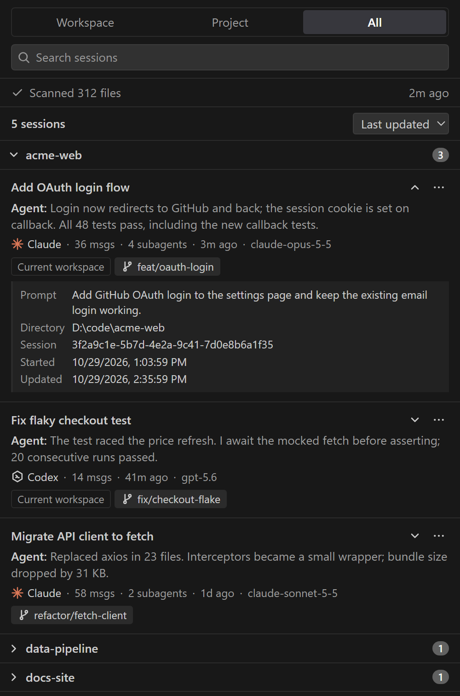

# Agent Session History

A VS Code sidebar that lists your local **Claude Code** and **Codex** sessions as cards, grouped by project, and resumes any of them in one click.

[繁體中文說明](README.zh-TW.md)



<sub>Screenshot with fictional sample sessions, Dark Modern theme.</sub>

## Features

### Browse
- **Three scopes:** Workspace (sessions started in the open folder), Project (the same git repository, including its other worktrees), and All. The chosen scope is remembered per workspace.
- **Project groups:** sessions are grouped by git repository, so all worktrees of a repository share one group; directories outside a repository are grouped by path. Groups collapse, and their state is remembered.
- **Session cards** show the title, the agent's last reply, message count, subagent count, model, branch, and how long ago the session was updated.
  - Claude cards use Claude's generated title; Codex cards use the thread name.
  - A **Current workspace** tag marks sessions from the open folder when viewing Project or All.
  - Subagent counts include nested Codex subagents. Codex threads split across several files are shown as one session.
- **Details:** expand a card to see the first prompt, working directory, session ID, and start and update times. Text there can be selected and copied.
- **Scan status** shows how many files were scanned and when. It warns when transcript lines were skipped for being too large, or when files could not be read.

### Find
- **Search** across title, first prompt, last reply, branch, model, directory, and session ID. Every space-separated word must match, ignoring case.
- **Sort** by last updated, created, or message count; the choice is remembered per workspace.
- **Filters:** non-interactive sessions (`codex exec`, `claude --print`) are hidden by default, and Codex `archived_sessions/` can be included. Both are settings.

### Resume
- **Click a card or press Enter** to resume the session in the agent's own VS Code extension: Claude Code for Claude sessions, Codex for Codex sessions.
- **Claude sessions from another folder** open in a new window on that folder after you confirm, and resume there automatically.
- **Resume in Terminal** runs `claude --resume <id>` or `codex resume <id>` in the session's directory. It is also offered when an agent extension is not installed.

### Delete old sessions
- **Move to Recycle Bin…** removes a session you no longer need, together with everything that belongs to it:
  - Claude: the transcript and its folder of subagent transcripts and tool results.
  - Codex: every page of the thread and the files of all its subagents, nested ones included.
- A confirmation shows the number of files and their total size first.
- Sessions updated in the last 10 minutes are refused, so a running session is never moved. The check runs again after you confirm.
- Files always go to the Recycle Bin (the system trash on other platforms), never deleted permanently, so you can restore them. The list refreshes right away.

### Inspect
- **Open Transcript** opens the raw `.jsonl` file read-only.
- **Reveal Transcript in File Explorer** and **Copy Session ID**.

### Use it your way
- **Menus:** every action is in the card's `⋯` menu and the right-click menu.
- **Keyboard:**
  - Up/Down move between rows and Home/End jump to the first or last row.
  - Right/Left expand or collapse groups and card details.
  - Enter resumes, and Shift+F10 or the Menu key opens the actions.
  - The list works as a tree for screen readers.
- **Themes:** colors follow your VS Code theme, including light, dark, and high contrast.
- **Stays current:** the list refreshes when transcripts change. A persistent cache keeps later scans to about 40 ms for roughly 900 files. Indexing starts only when the view is first opened.

## Requirements

- VS Code 1.100 or later.
- Git 2.31 or later on `PATH`.
  - Repository grouping and the Project scope use `git rev-parse --path-format=absolute --git-common-dir`; `--path-format` was added in Git 2.31.
  - Without it, sessions are grouped by directory only, and the Project scope shows only sessions inside the open folders.
- To resume in an extension instead of a terminal, install the extension for that agent:
  - [Claude Code](https://marketplace.visualstudio.com/items?itemName=anthropic.claude-code) (`anthropic.claude-code`)
  - Codex (`openai.chatgpt`)

## Install

### From a release

1. Download `agent-session-history-<version>.vsix` from the [Releases](https://github.com/wonhao80016/agent-session-history/releases) page.
2. Install it:

   ```sh
   code --install-extension agent-session-history-<version>.vsix
   ```

   Or, in VS Code: **Extensions** view → `⋯` → **Install from VSIX…**.
3. Run **Developer: Reload Window** in windows that were already open. The clock icon then appears in the Activity Bar.

### From source

Building needs Node.js 22 or later.

```sh
npm install
npm run package
code --install-extension agent-session-history-<version>.vsix
```

## How resuming works

Both entry points below are internal to the agent extensions, not documented APIs. They were read from Claude Code 2.1.311 and Codex 26.51021 and may change in later versions. If an agent extension is missing or disabled, the extension offers to resume in a terminal instead.

| Agent | Behavior |
|---|---|
| Codex | Opens the thread in a Codex editor tab from any window; Codex uses the thread's recorded working directory. |
| Claude Code | Claude Code resumes only sessions that belong to the window's first folder or another worktree of the same repository. For a session from another folder, you are asked first. The extension then opens that folder in a new window and resumes the session there. |

## Settings

| Setting | Default | Description |
|---|---|---|
| `agentSessionHistory.claudeDir` | `~/.claude` | Claude Code data directory (contains `projects/`). |
| `agentSessionHistory.codexDir` | `~/.codex` | Codex data directory (contains `sessions/`). |
| `agentSessionHistory.includeNonInteractive` | `false` | Also list non-interactive sessions such as `codex exec` and `claude --print`. |
| `agentSessionHistory.includeCodexArchived` | `false` | Also scan Codex `archived_sessions/`. |
| `agentSessionHistory.maxLineBytes` | `10485760` | Transcript lines larger than this are skipped (minimum 1 MiB). |

## Privacy and data

- The extension makes no network requests and has no telemetry.
- It reads transcripts from the Claude and Codex data directories (`~/.claude` and `~/.codex` by default) and never modifies them. The one exception is **Move to Recycle Bin…**: it moves files to the system trash, after a confirmation that shows the file count and size. It refuses sessions changed in the last 10 minutes.
- It runs read-only `git rev-parse` and `git worktree list` in session and workspace directories to group sessions by repository.
- It writes an index cache, about 1 MB, to VS Code's global storage, plus a small hand-off file when resuming Claude in a new window. The selected scope and sort order are kept in VS Code's workspace state. After uninstalling, you can delete `%APPDATA%\Code\User\globalStorage\local.agent-session-history` (or the equivalent on your OS).

## Limitations

- Transcript formats are internal to Claude Code and Codex and can change between CLI versions; unknown records are skipped.
- Developed and tested on Windows 11. Paths are handled for macOS and Linux, but those platforms have not been tested.
- A worktree that lies outside the open folder and has since been deleted cannot be matched to its repository, so its sessions appear only in the All scope.

## Development

| Command | Purpose |
|---|---|
| `npm run check` | Type-check the extension and webview, then bundle into `dist/` |
| `npm test` | Compile and run the unit tests (`node:test`) |
| `npm run package` | Build the `.vsix` |
| F5 | Run in an Extension Development Host |

The design notes, decisions, and measurements are in [`docs/PLAN.md`](docs/PLAN.md), written in Traditional Chinese.

## License

[MIT](LICENSE)
