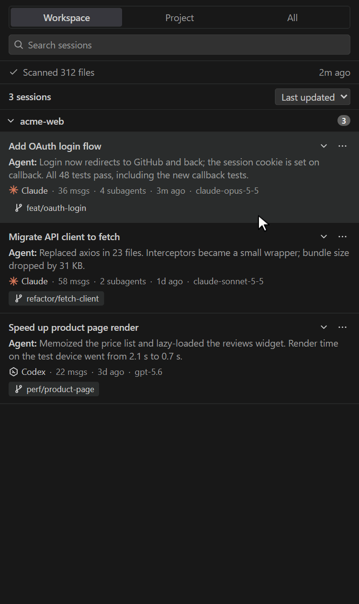

# Agent Session History

在 VS Code 側欄用卡片列出本機的 **Claude Code** 與 **Codex** session，依專案分組，點一下就能接續。

[English](README.md)



<sub>截圖使用虛構的範例 session，Dark Modern 主題。</sub>

## 功能

### 瀏覽
- **三種範圍：**
  - Workspace：在目前開啟的資料夾中開始的 session。
  - Project：同一個 git repo，包含它的其他 worktree。
  - All：全部 session。

  每個 workspace 會記住上次選的範圍。
- **專案分組：** 依 git repo 分組，同一個 repo 的所有 worktree 會在同一組；不在 repo 裡的目錄依路徑分組。群組可收合，收合狀態會記住。
- **資料夾已不存在：** 在 All 範圍中，目錄已被刪除、更名或移動的群組會標上 **Missing folder**，並排在其他群組之後。
- **session 卡片：** 顯示標題、agent 最後一句回覆、訊息數、subagent 數、模型、分支，以及多久以前更新。
  - Claude 卡片用 Claude 自動產生的標題，Codex 卡片用 thread 名稱。
  - 在 Project 或 All 範圍中，來自目前開啟資料夾的 session 會標上 **Current workspace**。
  - subagent 數包含 Codex 的多層 subagent。分成多個檔案的 Codex thread 會合併顯示成一個 session。
- **詳細資訊：** 展開卡片可看第一句提問、工作目錄、session ID、開始與更新時間，文字可以選取複製。
- **掃描狀態：** 顯示掃描了幾個檔案、多久以前掃描。有紀錄行因為太大被略過，或有檔案讀不到時，會顯示提示。

### 尋找
- **搜尋：** 搜尋範圍包括標題、第一句提問、最後一句回覆、分支、模型、目錄與 session ID。以空白分隔的每個詞都要符合，不分大小寫。
- **排序：** 可依最後更新、建立時間或訊息數排序，每個 workspace 會記住選擇。
- **篩選：** 預設隱藏非互動 session（`codex exec`、`claude --print`），也可以選擇納入 Codex 的 `archived_sessions/`。兩者都在設定中調整。

### 接續
- **點卡片或按 Enter**，就會用 agent 自己的 VS Code 擴充接續：Claude session 用 Claude Code，Codex session 用 Codex。
- **其他資料夾的 Claude session** 會先詢問，確認後開新視窗開啟該資料夾，並在新視窗自動接續。
- **Resume in Terminal** 會在 session 的工作目錄執行 `claude --resume <id>` 或 `codex resume <id>`。對應的擴充沒安裝時，也會提供這個選項。

### 刪除舊 session
- **Move to Recycle Bin…** 可以刪掉不再需要的 session，連同它的所有相關檔案：
  - Claude：主紀錄檔，以及存放 subagent 紀錄與工具輸出的同名資料夾。
  - Codex：thread 的所有分頁檔，以及所有 subagent 的檔案，包含多層 subagent。
- Missing folder 群組最上方的 **Move all to Recycle Bin…** 會一次移動群組中顯示的所有 session；搜尋中只會移動符合條件的 session。
- 刪除前會先跳確認視窗，顯示檔案數與總大小。
- 10 分鐘內有更新的 session 會拒絕刪除，避免動到正在執行的 session。按下確認後會再檢查一次。
- 一律移到資源回收筒（其他作業系統是系統垃圾桶），不會永久刪除，所以都能還原。刪除後清單會立即更新。

### 檢視
- **Open Transcript：** 以唯讀方式開啟原始的 `.jsonl` 紀錄。
- **Reveal Transcript in File Explorer** 與 **Copy Session ID**。

### 操作方式
- **選單：** 所有動作都可以從卡片的 `⋯` 選單或右鍵選單執行。
- **鍵盤：**
  - 上下鍵在各列之間移動，Home／End 跳到第一列或最後一列。
  - 左右鍵展開或收合群組與卡片詳細資訊。
  - Enter 接續，Shift+F10 或選單鍵開啟動作選單。
  - 螢幕閱讀器會把清單視為樹狀結構。
- **主題：** 顏色跟隨 VS Code 主題，淺色、深色、高對比都適用。
- **自動更新：** 紀錄檔有變動就更新清單。有快取，約 900 個檔案之後的掃描只需約 40 毫秒。側欄第一次打開後才開始建立索引。

## 需求

- VS Code 1.100 以上。
- git 2.31 以上，並且在 `PATH` 中。
  - repo 分組與 Project 範圍依 `git rev-parse --path-format=absolute --git-common-dir` 判斷，`--path-format` 是 git 2.31 才加入的選項。
  - git 版本太舊或找不到 git 時，session 只能依工作目錄分組，Project 範圍也只剩位於開啟資料夾內的 session。
- 想用擴充而不是終端接續的話，要安裝對應的擴充：
  - [Claude Code](https://marketplace.visualstudio.com/items?itemName=anthropic.claude-code)（`anthropic.claude-code`）
  - Codex（`openai.chatgpt`）

## 安裝

### 從 Release 安裝

1. 到 [Releases](https://github.com/wonhao80016/agent-session-history/releases) 頁面下載 `agent-session-history-<版本>.vsix`。
2. 安裝：

   ```sh
   code --install-extension agent-session-history-<版本>.vsix
   ```

   或在 VS Code 的 **Extensions** 面板 → `⋯` → **Install from VSIX…**。
3. 已開啟的視窗各執行一次 **Developer: Reload Window**，Activity Bar 就會出現 Agent Session History 圖示。

### 從原始碼建置

建置需要 Node.js 22 以上。

```sh
npm install
npm run package
code --install-extension agent-session-history-<版本>.vsix
```

## 接續方式

以下兩種開啟方式都是 agent 擴充的內部機制，不是公開 API。這裡依據的是 Claude Code 2.1.311 與 Codex 26.51021 的程式碼，之後的版本可能改變。對應的擴充沒有安裝或被停用時，會改提供在終端接續。

| Agent | 行為 |
|---|---|
| Codex | 在任何視窗都能以 Codex 編輯器分頁開啟；Codex 會使用該 thread 記錄的工作目錄。 |
| Claude Code | Claude Code 只能接續屬於目前視窗第一個資料夾，或同一 repo 其他 worktree 的 session。其他資料夾的 session 會先詢問你，同意後開新視窗開啟該資料夾，再在新視窗接續。 |

## 設定

| 設定 | 預設 | 說明 |
|---|---|---|
| `agentSessionHistory.claudeDir` | `~/.claude` | Claude Code 資料目錄（內含 `projects/`） |
| `agentSessionHistory.codexDir` | `~/.codex` | Codex 資料目錄（內含 `sessions/`） |
| `agentSessionHistory.includeNonInteractive` | `false` | 是否也列出 `codex exec`、`claude --print` 等非互動 session |
| `agentSessionHistory.includeCodexArchived` | `false` | 是否掃描 Codex 的 `archived_sessions/` |
| `agentSessionHistory.maxLineBytes` | `10485760` | 單行超過此大小就跳過（最小 1 MiB） |

## 隱私與資料

- 不連網，也不送遙測。
- 從 Claude 與 Codex 的資料目錄（預設為 `~/.claude` 與 `~/.codex`）讀取紀錄，從不修改。唯一的例外是「Move to Recycle Bin…」：確認視窗會先列出檔案數與大小，確認後才把檔案移到資源回收筒；10 分鐘內有更新的 session 會拒絕移動。
- 會在 session 與 workspace 的目錄執行唯讀的 `git rev-parse` 與 `git worktree list`，用來依 repo 分組。
- 寫入的東西：
  - VS Code globalStorage 裡的索引快取，約 1 MB。
  - 用新視窗接續 Claude 時的一個小交接檔。
  - 目前選的範圍與排序，存在 VS Code 的 workspace state。
- 移除擴充後，可以手動刪除 `%APPDATA%\Code\User\globalStorage\local.agent-session-history`（其他作業系統則是對應的位置）。

## 限制

- 紀錄檔格式是 Claude Code 與 Codex 的內部格式，CLI 升版就可能改變；不認得的紀錄一律略過。
- 只在 Windows 11 開發與測試過。程式有處理 macOS、Linux 的路徑，但沒有實測。
- 位於開啟資料夾以外、而且目錄已經刪除的 worktree，無法判斷屬於哪個 repo，它的 session 只會出現在 All 範圍。
- VS Code 開著時才被刪除的 repo 資料夾，在重新載入視窗之前仍會顯示為原本的 repo 群組，重新載入後才會標上 Missing folder。

## 開發

| 指令 | 用途 |
|---|---|
| `npm run check` | 型別檢查擴充與 webview，並打包到 `dist/` |
| `npm test` | 編譯並執行單元測試（`node:test`） |
| `npm run package` | 產生 `.vsix` |
| F5 | 在擴充開發主機中執行 |

設計說明、決策與實測數據見 [`docs/PLAN.md`](docs/PLAN.md)。

## 授權

[MIT](LICENSE)
